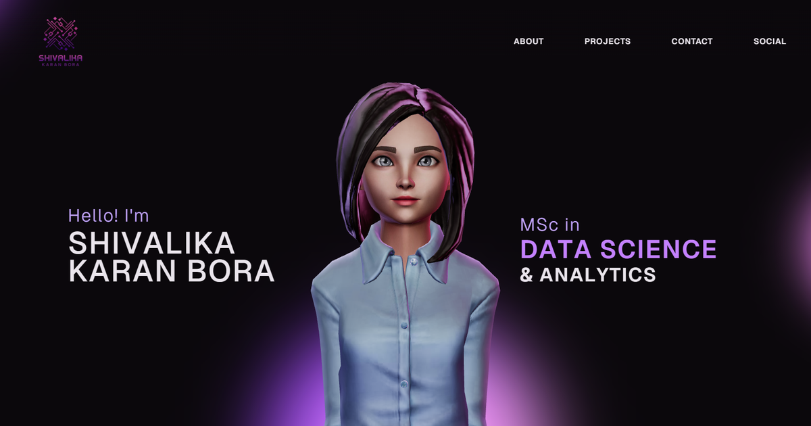

# Shivalika Karan Bora Portfolio

Interactive portfolio for Shivalika Karan Bora, Data Scientist and Data Engineer. Live at https://shivalika-portfolio.vercel.app



## Overview

This project is a modern portfolio website created with React, TypeScript, Vite, GSAP, and Three.js. It presents my professional experience, academic background, featured projects, technical skills, and contact information in an interactive and recruiter-friendly format.

## Features

- Responsive portfolio layout
- Interactive hero section with 3D character
- Separate sections for About, Work Experience, Academics, Projects, and Tech Stack
- GitHub and LinkedIn integration
- Downloadable resume link
- Smooth animations and modern UI styling

## Tech Stack

- React
- TypeScript
- Vite
- GSAP
- Three.js
- CSS

## Featured Projects

- **Building Energy Prediction**: LightGBM time-series forecasting on 20M+ meter readings (team project). [Code](https://github.com/ZahraSabouri/CMT307_GreatEnergyPredictor)
- **WasteWise AI**: full-stack waste classification app with a four-model CNN ensemble (team project). [Code](https://github.com/shivalika3101/WasteWise-AI)
- **AI Jobs Market Dashboard**: interactive Streamlit dashboard of AI hiring trends. [Live demo](https://ai-jobs-dashboard-i5zatt46vkovdwln3veuw9.streamlit.app/) · [Code](https://github.com/shivalika3101/AI-Jobs-Dashboard)
- **Fluffy AI Assistant**: desktop voice assistant prototype using Whisper. [Code](https://github.com/shivalika3101/Fluffy-AI-Assistant)
- **Image Analysis**: Tkinter image processing app. [Code](https://github.com/shivalika3101/Image-Analysis)

## Getting Started

```bash
npm install
npm run dev
```

The app runs locally at `http://localhost:5173`.

## Build

```bash
npm run build
```

## Contact

- Email: `shivalikauni@gmail.com`
- LinkedIn: `https://www.linkedin.com/in/shivalika31`
- GitHub: `https://github.com/shivalika3101`

## Credits

- 3D character: ["Business Girl"](https://sketchfab.com/3d-models/business-girl-c180f7eb4d6e430f82973bbf0417f5b9) by [aki74](https://sketchfab.com/aki74), licensed under [CC BY 4.0](https://creativecommons.org/licenses/by/4.0/).
